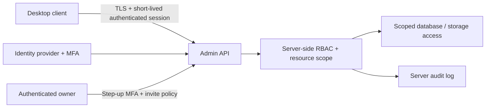

# Future admin security architecture

This is a design contract, not implemented authentication or authorization. The existing backend contains a health-only bootstrap and security preparation, not a production-ready admin API. Nothing here authorizes migration, deployment, service connection or privileged access.

## Client boundary

Treat the desktop app as an untrusted public client. UI hiding, a local role label or client-supplied user ID is never authorization. The desktop must never receive database passwords, Supabase service-role keys, privileged storage credentials, signing keys or shared admin API secrets. Compiled JavaScript, Electron main processes and preload scripts are not secret stores.

Future login should use the system browser with authorization code + PKCE, state/nonce verification, exact redirect validation and a trusted identity provider. Require MFA for every admin, preferably phishing-resistant credentials, with recent step-up verification for team access changes or other sensitive actions. The API validates token issuer, audience, expiry, signature, session revocation and current admin membership; it must fail closed. Keep access tokens short-lived and in memory. If persistent refresh sessions become necessary, use OS-protected credential storage and revocation/rotation, never renderer localStorage or bundled files. Logout and team removal revoke sessions server-side. Token handling and callback validation need a separate security review before implementation.

Renderer network access remains disabled in this prototype. A future API connection needs a narrowly allowlisted TLS origin and revised CSP, strict response validation, pagination and rate limits. Avoid arbitrary URL, filesystem, shell or database IPC bridges. Any future IPC must expose individual typed operations, verify the sender and validate every payload in the main process. Do not expose Electron/Node APIs directly.

## Admin API and server-side RBAC

Use the planned modular FastAPI backend with a separately scoped admin API surface. Every request, including read/search/export, must authenticate and authorize on the server. Validate role, resource scope, account status and action-specific policy against authoritative server state; never accept a role from the desktop as proof. Default deny, explicit permission maps, least-privilege service identities, bounded queries, parameterized SQL and storage policy enforcement are required. Privileged provider credentials stay in server-managed secrets with rotation and restricted access. Use scoped database roles; reserve migration/owner access for controlled operations outside the desktop.

Illustrative roles: Owner controls invitations and governance; Moderator reviews permitted reports; Trainer reviewer handles trainer verification; Commerce operator handles explicitly permitted catalog/order tasks; Analyst sees aggregate reports only. These roles are concepts, not implemented permissions. Separate approval-sensitive changes, prevent self-elevation and check object access as well as endpoint access. Sensitive writes require validated reasons, idempotency, concurrency protection and transaction boundaries; payment/refund operations require their own provider and reconciliation design.

## Owner-controlled team invitations

Only an authenticated, currently authorized Owner can create/revoke an invite, with recent MFA. Bind a single-use, short-lived opaque token to the intended recipient, workspace and permitted role; store only its hash. Require authenticated matching-recipient acceptance and MFA enrollment before activation. Reject expired, replayed, revoked and cross-workspace tokens. Apply server-side role constraints and ensure invitations cannot self-elevate or create an unintended Owner. Owner transfer requires a separate controlled procedure; preserve the last active Owner. Rate-limit invitations and audit creation, revocation, acceptance, role changes and failures. Never put raw invitation tokens in telemetry or audit records.

## Audit and operational controls

Write server-side, append-only audit events for authentication/security failures, privileged reads, administrative mutations, permission changes and invite lifecycle events. Include actor/session, action, object scope, timestamp, outcome, reason and correlation ID; redact credentials, tokens and unnecessary personal data. Couple successful sensitive mutations with durable audit persistence transactionally or through a reliable outbox. Restrict audit access and define retention, tamper detection, incident review and alerting. Client-generated activity is not an authoritative audit trail.

Before any real integration: review threats and permissions; implement authorization and MFA/revocation integration tests, invite replay/race/last-owner tests and audit-failure tests; verify database/storage policies in an isolated environment; review privacy and retention; establish incident response, backups and recovery. Windows signing, dependency updates, secure release distribution and authenticated update provenance require separate approval and implementation. No production-readiness claim follows from this prototype's passing UI tests.

## Present Electron protections

The prototype loads an allowlist of built local assets through a custom secure scheme. It enables context isolation, renderer sandboxing and web security; disables Node integration and webviews; denies permissions, downloads, child windows, navigation/redirects and non-asset requests; and applies a restrictive offline CSP. There is no preload or IPC bridge. These measures reduce the desktop surface but do not replace API authentication, RBAC or a security audit.

References: [Electron security recommendations](https://www.electronjs.org/docs/latest/tutorial/security/), [context isolation](https://www.electronjs.org/docs/latest/tutorial/context-isolation), [custom protocols](https://www.electronjs.org/docs/latest/api/protocol). Existing repository plans: [authentication architecture](../docs/authentication-architecture.md), [main architecture](../ARCHITECTURE.md).
